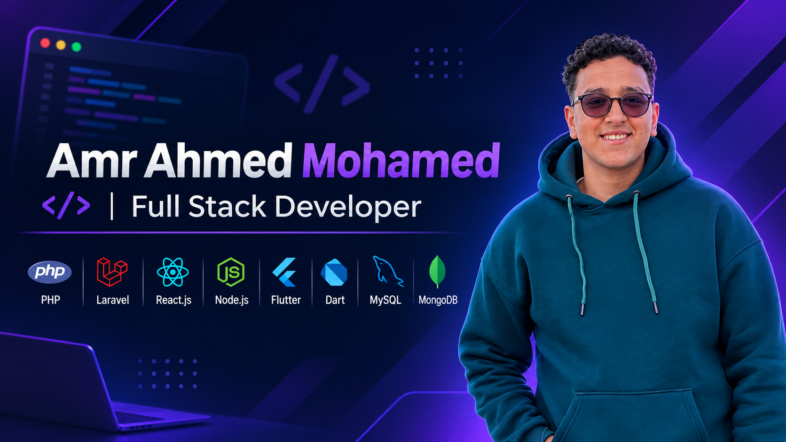

  

<h1 align="center">👋 Hi, I'm Amr Ahmed Mohamed</h1>

<h3 align="center">
  Full Stack Developer | PHP & Laravel | React.js | Flutter & Dart
</h3>

  Building modern web and mobile applications with clean code and practical solutions.

---

### 👨‍💻 About Me

- 💻 Full Stack Developer interested in building real-world applications.
- 🚀 Backend Development using PHP and Laravel.
- 🌐 Frontend Development using React.js, JavaScript, HTML and CSS.
- 📱 Mobile App Development using Flutter and Dart.
- 🗄️ Working with MySQL and MongoDB databases.
- 📚 Always learning and improving my development skills.

---

### 🛠️ Tech Stack

**Backend Development**

  

**Frontend Development**

  

**Mobile Development**

  

**Databases & Tools**

  

---

### 🎯 What I'm Focused On

- Developing full-stack web applications.
- Building responsive and modern user interfaces.
- Improving my Laravel and React.js skills.
- Developing mobile applications using Flutter.
- Learning new technologies and building practical projects.

---

### 📊 GitHub Stats

  
  

---

### 🤝 Connect With Me

  
  

---

  ⭐ Building meaningful solutions, one line of code at a time.

